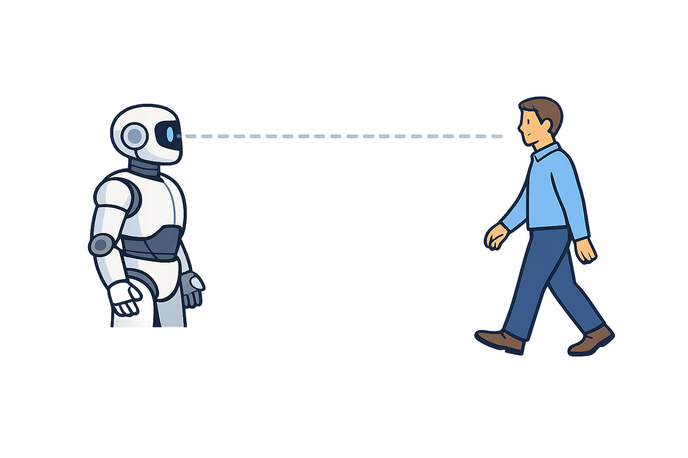
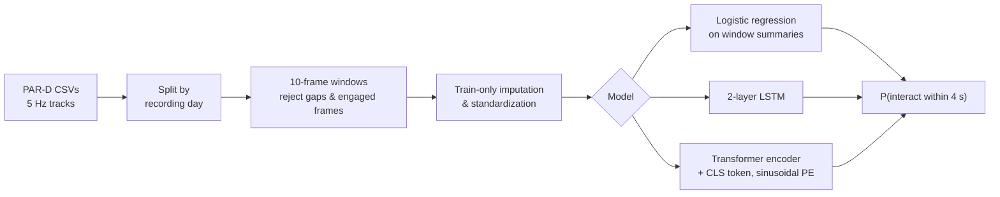
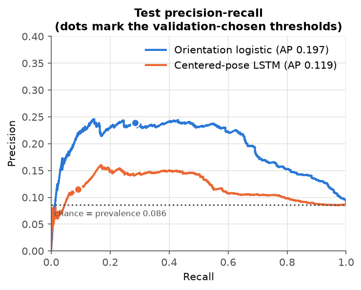
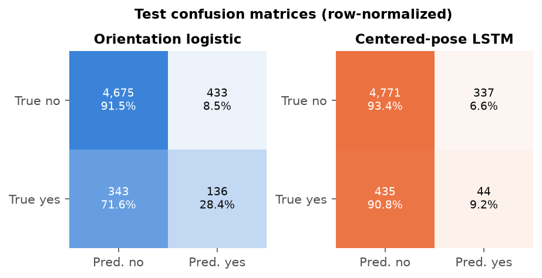
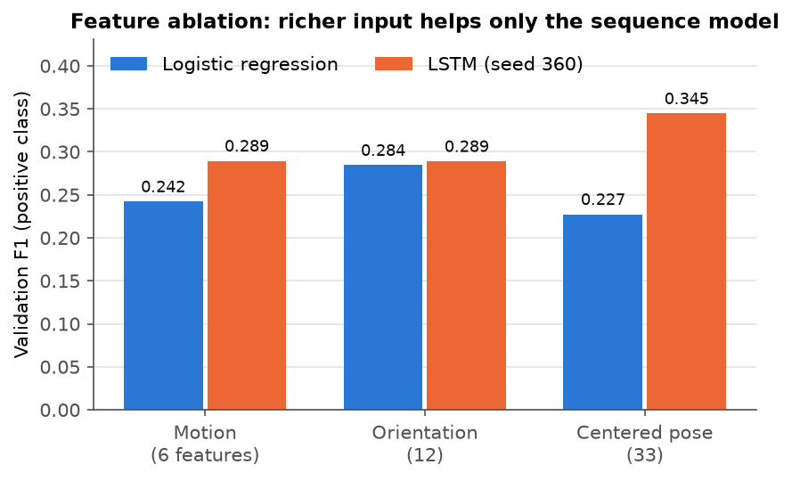
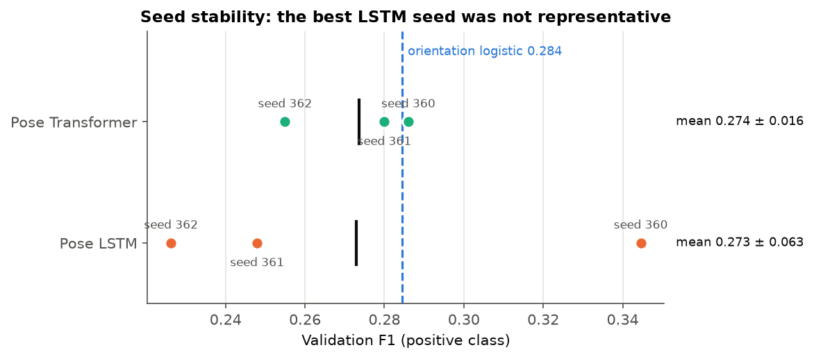
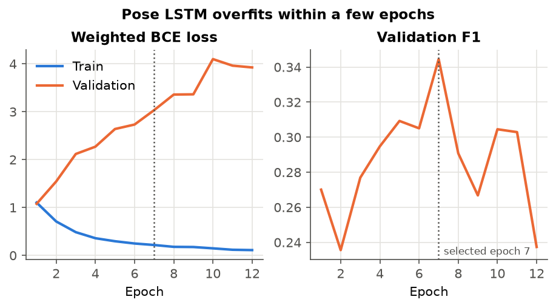
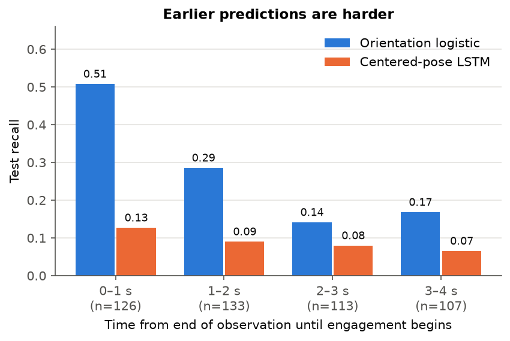

# Will They Talk to the Robot?

**Early prediction of human engagement intent for social robots, from 2 seconds of body motion.**

<p align="center">
  
</p>

A robot in a public lobby sees people walk past it all day. A few of them are about to stop and interact. If the robot can recognize those people a few seconds early, it can greet them proactively and leave everyone else alone. This repository is an end-to-end PyTorch pipeline that frames the problem as **sequence classification on real-world skeleton-tracking data**. It covers the data audit, leakage-safe preprocessing, baselines, LSTM and Transformer models, ablations, and a single frozen held-out evaluation.


---

## Highlights

- **Real, messy data.** 139k frames of 5 Hz Kinect tracking from the public [PAR-D Shutter dataset](https://doi.org/10.60600/YU/KFFQPF): 2,429 people across 13 days and two lobbies, with only **5% positive windows**.
- **Leakage-safe by design.** Whole recording *days* are assigned to train/validation/test *before* overlapping windows are built. Label-construction columns are explicitly blocked, and normalization is fit on training data only.
- **Honest evaluation.** Checkpoints and thresholds were selected on validation F1. The test split was read **exactly once**, after every choice was frozen.
- **A negative result, reported properly.** The best LSTM beat logistic regression on validation (F1 0.345 vs 0.284). On unseen days it collapsed to 0.102, while the simple model held at 0.260. Multi-seed runs showed the LSTM's validation win was a lucky seed.
- **Fully reproducible.** Each run gets a unique directory with its config, git revision, seed, device, package versions, checkpoint, and predictions. Every figure below is regenerated from those artifacts by one command.

## How it works



| | |
|---|---|
| **Input** | `[batch, 10 frames, F]`: 2 s at 5 Hz, robot-relative features |
| **Target** | 1 if the person begins interacting within 4 s after the window ends |
| **Feature sets** | *Motion* (6): distance, speed, velocity, bearing. *Orientation* (12): + head/body heading. *Centered pose* (33): + pelvis-centered head, shoulder, wrist, ankle joints |
| **Loss** | `BCEWithLogitsLoss` with a training-split positive weight (~20.8) |
| **Selection** | Validation positive-class F1 for checkpoints, thresholds, features, and window length |

## Results

### Held-out recording days (frozen, evaluated once)

5,587 windows from two dates never used for fitting or selection (479 positives, 8.6%).

| Selected model | Threshold | Accuracy | Precision | Recall | **F1** | Avg. precision |
| --- | ---: | ---: | ---: | ---: | ---: | ---: |
| Always predict "no" | — | 0.914 | 0.000 | 0.000 | 0.000 | — |
| **Orientation logistic regression** | 0.80 | 0.861 | 0.239 | 0.284 | **0.260** | **0.197** |
| Centered-pose LSTM | 0.83 | 0.862 | 0.115 | 0.092 | 0.102 | 0.119 |

<p align="center">
  
  
</p>

Accuracy is misleading here because a model that always says "no" scores 91.4%. Positive-class F1 and the precision-recall curve are the metrics that matter. The simple model dominates the LSTM across the whole PR curve, not only at the chosen threshold.

### Validation experiments

<p align="center">
  
  
</p>

- **Features.** Adding pelvis-centered pose helped the LSTM (+0.056 F1) but *hurt* logistic regression, so the gain was not simply from more inputs.
- **Seeds.** Across seeds 360–362 the pose LSTM averaged **0.273 ± 0.063**, and the Transformer (69.5k params) averaged **0.274 ± 0.016**. The Transformer is about 4× more stable, but neither beats the 49-coefficient logistic baseline (0.284).
- **History length.** 1 s / 2 s / 3 s windows gave 0.274 / **0.345** / 0.284. Longer context also shrinks the pool of eligible pre-engagement windows.

<p align="center">
  
</p>

The LSTM memorizes training days within a few epochs: training loss falls while validation loss climbs. Combined with seed variance and the test collapse, this points to **overfitting plus day-to-day distribution shift**.

### How early can intent be predicted?

<p align="center">
  
</p>

Joining each test positive with the dataset's time-to-engagement shows a steep drop. The logistic model catches **51%** of people whose window ends within one second of engagement, but only **14–17%** two to four seconds out. With motion and orientation features, most of the signal shows up in the final second. *(Post-hoc description of frozen predictions; nothing here was used for model selection.)*

Full tables, subgroup results, qualitative examples, and run IDs are in **[docs/RESULTS.md](docs/RESULTS.md)**.

## Takeaways

1. **Start with a strong simple baseline.** A logistic model on four summary statistics per feature was the most robust model.
2. **One seed is an anecdote.** The headline LSTM result disappeared under two more seeds.
3. **Split by the unit you will deploy on.** Splitting by recording day exposed a generalization gap that frame- or scenario-level splits would hide.
4. **Freeze before you test.** Because the test set was read once, the negative result is trustworthy rather than tuned away.

## Quickstart

```bash
python -m venv .venv
source .venv/bin/activate            # Windows: .\.venv\Scripts\activate
pip install -e ".[dev]"
pytest                               # 26 fast unit and smoke tests (CPU)
```

Download the [PAR-D release](https://doi.org/10.60600/YU/KFFQPF) to `data/raw/par-d/`, then:

```bash
# 1. Audit and stage the raw archive (raw files are never modified)
python -m engagement_intent.data.inspect --data-dir data/raw/par-d --output data/processed/raw_inventory.json
python -m engagement_intent.data.stage   --archive data/raw/par-d/doi-10.60600-yu-kffqpf.zip --output-dir data/processed/par-d-v1

# 2. Build leakage-safe windows (one call per feature set / window length)
python -m engagement_intent.data.preprocess --config configs/preprocess.yaml --feature-set pose --observation-seconds 2

# 3. Train (validation-only selection; the test split is not read)
python -m engagement_intent.training.baseline    --config configs/baseline.yaml
python -m engagement_intent.training.lstm        --config configs/lstm.yaml
python -m engagement_intent.training.transformer --config configs/transformer.yaml

# 4. One-time held-out evaluation, after every choice is frozen
python -m engagement_intent.evaluation.final --baseline-run outputs/<BASELINE_RUN> --lstm-run outputs/<LSTM_RUN>

# 5. Regenerate every figure in this README from saved artifacts
python -m engagement_intent.evaluation.figures --final-run outputs/<FINAL_EVAL_RUN> --output-dir assets/figures
```

For CUDA 11.8: `pip install --force-reinstall --no-deps torch==2.5.1+cu118 --index-url https://download.pytorch.org/whl/cu118`. Code is device-agnostic (`device: auto`).

## Repository structure

```text
├── assets/                     # README images and generated result figures
├── configs/                    # YAML configs: preprocessing, baseline, LSTM, Transformer
├── docs/
│   ├── DATA.md                 # Dataset audit: schema, labels, split policy, leakage controls
│   ├── RESULTS.md              # All validation and test results with run IDs
│   └── MODEL_CARD.md           # Intended use, limitations, ethical considerations
├── report/                     # LaTeX technical report (source + bibliography)
├── src/engagement_intent/
│   ├── data/                   # inspect.py, stage.py, preprocess.py (windows, splits, normalization)
│   ├── models/                 # lstm.py, transformer.py (raw-logit classifiers)
│   ├── training/               # baseline.py, lstm.py, transformer.py (config-driven entry points)
│   └── evaluation/             # metrics.py, final.py (frozen test), figures.py (plots)
├── tests/                      # pytest suite: data logic, models, metrics, evaluation, figures
└── pyproject.toml
```

Raw data, processed windows, checkpoints, and run directories are git-ignored. Only configs, code, and small reviewed summaries are tracked.

## Documentation

- **[Technical report](report/main.tex)**: a 6-page write-up with related work, method, results, and discussion. Build instructions are in [report/README.md](report/README.md).
- **[Data audit](docs/DATA.md)**: what PAR-D actually contains, verified label semantics, and why each column is used or banned.
- **[Results](docs/RESULTS.md)**: every reported number traced to a run directory.
- **[Model card](docs/MODEL_CARD.md)**: intended use, out-of-scope uses, and known failure modes.

## Limitations and responsible use

- The test set holds unseen *days* from the same two lobbies, not a new building. Cross-site generalization is untested.
- "Future interaction" is a behavioral proxy for intent, and similar approach-and-stop motion can receive opposite labels.
- The intended use is low-stakes and reversible: greet, wait, or don't interrupt. It is **not** meant for surveillance, access control, or any consequential decision. The dataset contains numeric skeleton tracks only, with no images of people.

## Citation and acknowledgments

Data: the PAR-D Shutter Interaction Dataset (CC0 1.0), Yale Dataverse, [doi:10.60600/YU/KFFQPF](https://doi.org/10.60600/YU/KFFQPF). Please cite the dataset authors if you use it; see [`report/references.bib`](report/references.bib).

Development was assisted by AI coding tools.

## License

Code is released under the [MIT License](LICENSE). The PAR-D dataset is distributed separately by its authors under CC0 1.0 and is not included in this repository. All design decisions, experiments, and interpretation are documented in this repository.
