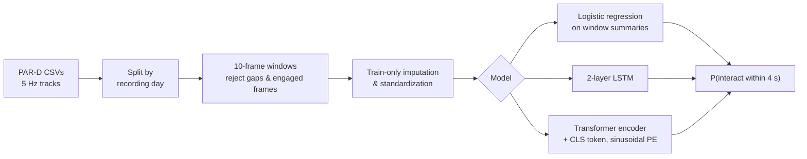

# Will They Talk to the Robot?

Predicting whether a passerby is about to interact with a social robot, using two seconds of their body motion.

<p align="center">
  
</p>

A robot in a public lobby sees people walk past it all day. A few of them are about to stop and interact. If the robot can recognize those people a few seconds early, it can greet them proactively and leave everyone else alone. This repo treats that as a sequence classification problem on real skeleton-tracking data and works through it end to end in PyTorch: auditing the dataset, building windows without leaking between splits, training baselines, an LSTM, and a Transformer, running ablations, and finally scoring the chosen models once on held-out data.


---

## TL;DR

I used the public [PAR-D Shutter dataset](https://doi.org/10.60600/YU/KFFQPF), which has about 139k frames of 5 Hz Kinect tracking covering 2,429 people over 13 days in two university lobbies. Only around 5% of the two-second windows end shortly before someone starts interacting, so the classes are very imbalanced.

I split the data by recording day before building any windows, so nothing from a test day leaks into training. Every modeling choice (features, window length, checkpoints, thresholds) was made on validation data, and the test days were scored once at the very end.

The LSTM looked best on validation (F1 0.345 against 0.284 for logistic regression), but on the unseen test days it dropped to 0.102 while logistic regression held up at 0.260. Rerunning the LSTM with a couple more seeds showed its validation score had mostly been a lucky seed. In short, a simple model on summary features generalized better than the deep models, and most of the predictive signal only shows up in the last second before someone engages.

Every run saves its config, git revision, seed, and predictions, and all the figures below can be regenerated from those saved runs with one command.

## How it works



| | |
|---|---|
| Input | `[batch, 10 frames, F]`: 2 s at 5 Hz, robot-relative features |
| Target | 1 if the person starts interacting within 4 s after the window ends |
| Feature sets | Motion (6): distance, speed, velocity, bearing. Orientation (12): motion plus head and body heading. Centered pose (33): orientation plus pelvis-centered head, shoulder, wrist, and ankle joints |
| Loss | `BCEWithLogitsLoss` with a positive-class weight from the training split (~20.8) |
| Selection | Validation positive-class F1, used for checkpoints, thresholds, features, and window length |

## Results

### Held-out recording days (frozen, evaluated once)

5,587 windows from two dates never used for fitting or selection (479 positives, 8.6%).

| Selected model | Threshold | Accuracy | Precision | Recall | F1 | Avg. precision |
| --- | ---: | ---: | ---: | ---: | ---: | ---: |
| Always predict "no" | — | 0.914 | 0.000 | 0.000 | 0.000 | — |
| Orientation logistic regression | 0.80 | 0.861 | 0.239 | 0.284 | 0.260 | 0.197 |
| Centered-pose LSTM | 0.83 | 0.862 | 0.115 | 0.092 | 0.102 | 0.119 |

<p align="center">
  
  
</p>

Accuracy isn't very useful here, since a model that always says "no" already gets 91.4%. Positive-class F1 and the precision-recall curve tell you more. Logistic regression beats the LSTM along almost the whole PR curve, so the gap isn't just an artifact of where the thresholds landed.

### Validation experiments

<p align="center">
  
  
</p>

- Features: adding pelvis-centered pose helped the LSTM (+0.056 F1) but hurt logistic regression, so the gain wasn't just from having more inputs.
- Seeds: across seeds 360–362 the pose LSTM averaged 0.273 ± 0.063 and the Transformer (69.5k params) averaged 0.274 ± 0.016. The Transformer was about 4× more stable, but neither beat the 49-coefficient logistic baseline (0.284).
- Window length: 1 s, 2 s, and 3 s windows gave 0.274, 0.345, and 0.284. Longer windows also leave fewer eligible windows before each engagement.

<p align="center">
  
</p>

The LSTM starts memorizing the training days within a few epochs, with training loss falling while validation loss climbs. Together with the seed variance and the drop on test, this looks like overfitting combined with shift between recording days.

### How early can intent be predicted?

<p align="center">
  
</p>

Matching each test positive to the dataset's time-to-engagement column shows recall falling off quickly. The logistic model catches 51% of people whose window ends within a second of engaging, but only 14–17% when they're two to four seconds away. With motion and orientation features, most of the signal arrives in that last second. This is a post-hoc look at the frozen test predictions, and none of it fed back into model selection.

Full tables, subgroup results, qualitative examples, and run IDs are in [docs/RESULTS.md](docs/RESULTS.md).

## Takeaways

1. A strong simple baseline is worth having. Logistic regression on four summary statistics per feature ended up being the most robust model.
2. One seed isn't enough. The LSTM's best validation result mostly went away after two more seeds.
3. Split the way you'd deploy. Splitting by recording day exposed a generalization gap that frame- or scenario-level splits would have hidden.
4. Lock everything in before touching the test set. Since the test days were only scored once, the LSTM's poor test result is an honest one and wasn't tuned away.

## Quickstart

```bash
python -m venv .venv
source .venv/bin/activate            # Windows: .\.venv\Scripts\activate
pip install -e ".[dev]"
pytest                               # 26 fast unit and smoke tests (CPU)
```

Download the [PAR-D release](https://doi.org/10.60600/YU/KFFQPF) to `data/raw/par-d/`, then:

```bash
# 1. Audit and stage the raw archive (raw files are never modified)
python -m engagement_intent.data.inspect --data-dir data/raw/par-d --output data/processed/raw_inventory.json
python -m engagement_intent.data.stage   --archive data/raw/par-d/doi-10.60600-yu-kffqpf.zip --output-dir data/processed/par-d-v1

# 2. Build leakage-safe windows (one call per feature set / window length)
python -m engagement_intent.data.preprocess --config configs/preprocess.yaml --feature-set pose --observation-seconds 2

# 3. Train (validation-only selection; the test split is not read)
python -m engagement_intent.training.baseline    --config configs/baseline.yaml
python -m engagement_intent.training.lstm        --config configs/lstm.yaml
python -m engagement_intent.training.transformer --config configs/transformer.yaml

# 4. One-time held-out evaluation, after every choice is frozen
python -m engagement_intent.evaluation.final --baseline-run outputs/<BASELINE_RUN> --lstm-run outputs/<LSTM_RUN>

# 5. Regenerate every figure in this README from saved artifacts
python -m engagement_intent.evaluation.figures --final-run outputs/<FINAL_EVAL_RUN> --output-dir assets/figures
```

For CUDA 11.8: `pip install --force-reinstall --no-deps torch==2.5.1+cu118 --index-url https://download.pytorch.org/whl/cu118`. Code is device-agnostic (`device: auto`).

## Repository structure

```text
├── assets/                     # README images and generated result figures
├── configs/                    # YAML configs: preprocessing, baseline, LSTM, Transformer
├── docs/
│   ├── DATA.md                 # Dataset audit: schema, labels, split policy, leakage controls
│   ├── RESULTS.md              # All validation and test results with run IDs
│   └── MODEL_CARD.md           # Intended use, limitations, ethical considerations
├── report/                     # LaTeX technical report (source + bibliography)
├── src/engagement_intent/
│   ├── data/                   # inspect.py, stage.py, preprocess.py (windows, splits, normalization)
│   ├── models/                 # lstm.py, transformer.py (raw-logit classifiers)
│   ├── training/               # baseline.py, lstm.py, transformer.py (config-driven entry points)
│   └── evaluation/             # metrics.py, final.py (frozen test), figures.py (plots)
├── tests/                      # pytest suite: data logic, models, metrics, evaluation, figures
└── pyproject.toml
```

Raw data, processed windows, checkpoints, and run directories are git-ignored. Only configs, code, and small reviewed summaries are tracked.

## Documentation

- [Technical report](report/main.tex): a 6-page write-up covering related work, method, results, and discussion. Build instructions are in [report/README.md](report/README.md).
- [Data audit](docs/DATA.md): what PAR-D actually contains, how the labels work, and why each column is used or excluded.
- [Results](docs/RESULTS.md): every reported number, with the run directory it came from.
- [Model card](docs/MODEL_CARD.md): intended use, out-of-scope uses, and known failure modes.

## Limitations and responsible use

- The test set is unseen days from the same two lobbies, not a new building, so how well this transfers to a new site is untested.
- "Starts interacting within 4 s" is a behavioral stand-in for intent, and very similar approach-and-stop motion can end up with opposite labels.
- The intended use is low-stakes and reversible: greet, wait, or don't interrupt. It is not meant for surveillance, access control, or any consequential decision. The dataset contains numeric skeleton tracks only, with no images of people.

## Citation and acknowledgments

Data: the PAR-D Shutter Interaction Dataset (CC0 1.0), Yale Dataverse, [doi:10.60600/YU/KFFQPF](https://doi.org/10.60600/YU/KFFQPF). Please cite the dataset authors if you use it; see [`report/references.bib`](report/references.bib).

Development was assisted by AI coding tools.

## License

Code is released under the [MIT License](LICENSE). The PAR-D dataset is distributed separately by its authors under CC0 1.0 and is not included in this repository. All design decisions, experiments, and interpretation are documented in this repository.
